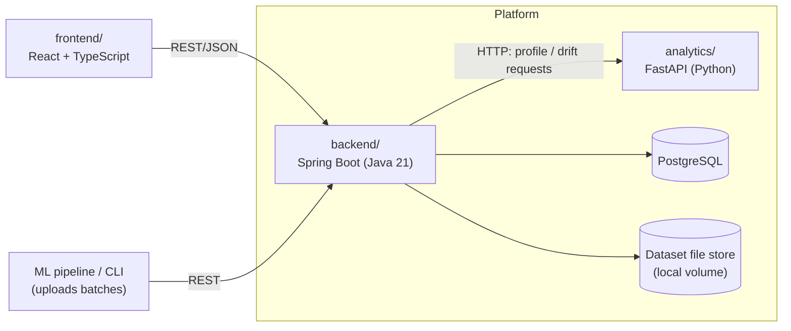

# DriftWatch Architecture

Status: **Proposed** (Milestone 0). Nothing below is implemented yet; this
document is the target the roadmap builds toward. Sections are updated as
each component lands.

## 1. Goals and non-goals

**Goals**

- Register a model and a *reference dataset* (the data the model was trained or
  validated on).
- Accept *current* batches of production inputs, predictions and (later)
  ground-truth labels.
- Compute data drift, prediction drift and performance degradation with
  documented statistical methods.
- Persist every monitoring run so results are auditable and reproducible.
- Show results in a web dashboard.

**Non-goals for v1**

- Real-time / streaming monitoring (v1 is batch-oriented).
- Multivariate drift detection (v1 is per-feature; see
  [ML_MONITORING_DESIGN.md](ML_MONITORING_DESIGN.md#9-limitations)).
- Multi-tenancy, user accounts, SSO.
- Model serving. DriftWatch observes models; it does not host them.

## 2. System overview



Three deployable units plus a database:

| Component   | Responsibility | Owns state? |
|-------------|----------------|-------------|
| `backend`   | Public REST API, validation of requests, model & dataset registry, monitoring-run lifecycle, persistence, orchestration of the analytics engine. | Yes (PostgreSQL + file store) |
| `analytics` | Stateless statistical engine: schema inference, reference profiling, drift tests, performance metrics. | **No** |
| `frontend`  | Dashboard for models, runs and per-feature results. | No |
| PostgreSQL  | System of record for metadata, profiles and results. | — |

## 3. Why two backend services (and only two)

The project brief warns against unnecessary microservices, so this split needs
a real justification:

- The statistics (SciPy, NumPy, Pandas, scikit-learn) have no equally mature,
  well-tested Java equivalents. Re-implementing KS tests or quantile binning
  in Java would be slower to build and more likely to be wrong.
- The platform concerns (REST API, transactions, migrations, validation,
  background execution) fit Spring Boot well.

The split is kept as narrow as possible:

- `analytics` is **stateless** — no database, no filesystem, no scheduling.
  Given the same inputs and engine version it returns the same output. That
  makes it easy to unit test and to reason about reproducibility.
- Only `backend` talks to PostgreSQL. There is exactly one source of truth.
- Communication is synchronous HTTP + JSON/multipart. No message broker until
  there is a measured need for one.

Alternative considered: a single Python service (FastAPI + SQLAlchemy). It
would be simpler to operate, but the stack in the brief explicitly includes
Java/Spring Boot, and the separation of "platform" and "math" is a defensible
boundary rather than an artificial one.

## 4. Core domain concepts

| Concept | Meaning |
|---------|---------|
| **Monitored model** | A named model (e.g. `credit-risk`) with a task type (`binary_classification`, `multiclass_classification`, `regression`), a target column and a prediction column. |
| **Dataset** | An uploaded CSV file with a role (`REFERENCE` or `CURRENT`), SHA-256 content hash, row count and inferred schema. |
| **Feature schema** | Per-column name, logical type (`numeric`, `categorical`, `boolean`, `datetime`, `text`/unsupported), nullability. Inferred from the reference dataset, then *enforced* on current batches. |
| **Reference profile** | A compact, deterministic summary of the reference dataset computed once by `analytics`: bin edges and proportions, category frequencies, missing rates and a capped seeded sample for tests that need raw values. Stored as JSONB. |
| **Monitoring run** | One comparison of a current batch against a model's reference profile, with an immutable configuration (methods, thresholds, engine version). Status: `PENDING → RUNNING → SUCCEEDED / FAILED`. |
| **Feature drift result** | Per-feature output of a run: method, statistic, p-value (where applicable), threshold, drift flag, sample sizes, warnings. |

## 5. Main workflows

### 5.1 Register a reference dataset

1. Client `POST`s a CSV to `backend`.
2. `backend` validates size/encoding, computes SHA-256, stores the file in the
   file store (content-addressed: same file → same path), records metadata.
3. `backend` sends the file to `analytics` `/v1/profile`.
4. `analytics` infers the schema and builds the reference profile.
5. `backend` persists schema + profile and marks the dataset `READY`
   (or `FAILED` with the engine's error).

### 5.2 Run drift monitoring on a current batch

1. Client uploads a current CSV for a model.
2. `backend` validates it against the stored schema (missing columns, extra
   columns, type mismatches) and creates a `PENDING` run.
3. A bounded background executor sends the profile + current batch to
   `analytics` `/v1/drift`. Schema validation happens in the engine, so a
   mismatching batch becomes a `FAILED` run with `schema-mismatch`.
4. Results are written in one transaction; the run becomes `SUCCEEDED`.
   Any engine error, timeout or validation failure produces `FAILED` with a
   recorded reason — never a silently partial result. Implemented (2.7);
   details in [backend/README.md](backend/README.md#monitoring-runs).

### 5.3 Performance monitoring (Milestone 3)

Ground-truth labels often arrive later than predictions. Labels are uploaded
separately and joined to predictions by a client-supplied `record_id`.
Performance metrics are computed only on the joined subset, and the join rate
is reported alongside the metrics.

## 6. Data model (initial sketch)

```text
monitored_model(id, name UNIQUE, task_type, target_column, prediction_column,
                created_at)
dataset(id, model_id FK, role, sha256, byte_size, original_filename,
        created_at)                      -- V2; row_count, status, schema: 2.6
reference_profile(id, model_id FK, dataset_id UNIQUE, engine_version,
                  row_count, profile JSONB, issues JSONB, created_at)
                  -- V3; FK (dataset_id, model_id, 'REFERENCE') -> dataset
monitoring_run(id, model_id FK, reference_profile_id FK, current_dataset_id FK
               UNIQUE, status, requested_config JSONB, engine_version,
               result JSONB, error_kind, error_message, error_details JSONB,
               created_at, started_at, finished_at)
               -- V4; check constraints tie each status to its fields
```

The earlier sketch had a separate `feature_drift_result` table. It was
dropped in 2.7 (decision D7): the engine's response is stored whole, as the
reference profile is.

Schema migrations are managed with Flyway; tables are never modified by hand.
Each table is added by the migration of the feature that first uses it (V1:
`monitored_model`), and Hibernate only validates the schema. Primary keys
are application-generated UUIDs.

## 7. API surface (planned, versioned under `/api/v1`)

| Method | Path | Purpose |
|--------|------|---------|
| `POST` | `/api/v1/models` | Register a model (implemented; contract in [backend/README.md](backend/README.md#model-registry-api)) |
| `GET`  | `/api/v1/models/{id}` | Get model details (implemented) |
| `GET`  | `/api/v1/models` | List models, paginated (implemented) |
| `POST` | `/api/v1/models/{id}/reference` | Upload reference dataset (implemented; [contract](backend/README.md#reference-registration-api)) |
| `GET`  | `/api/v1/models/{id}/reference` | Current reference and its inferred schema (implemented) |
| `POST` | `/api/v1/models/{id}/runs` | Upload current batch and start a run (implemented; [contract](backend/README.md#monitoring-runs)) |
| `GET`  | `/api/v1/runs/{runId}` | Run status and summary (implemented) |
| `GET`  | `/api/v1/runs/{runId}/features` | Per-feature drift results (implemented) |
| `GET`  | `/api/v1/models/{id}/runs` | Run history, paginated (implemented) |

Internal engine API (`analytics`, not exposed publicly):

| Method | Path | Purpose |
|--------|------|---------|
| `GET`  | `/health` | Liveness + engine version |
| `POST` | `/v1/profile` | Infer schema and build a reference profile |
| `POST` | `/v1/drift` | Compare a current batch to a profile |

The engine endpoints are implemented; their full request/response and
error contract is in [analytics/README.md](analytics/README.md#api). The
engine also returns RFC 9457 problem details, with stable `type` URNs that
the backend can map to its own errors.

Errors use RFC 9457 *Problem Details* (`application/problem+json`) in
`backend`. Exact request/response contracts are documented as each endpoint
is implemented.

## 8. Cross-cutting concerns

- **Validation:** request validation at the API boundary (Bean Validation);
  data validation (schema, types, missing values) in the engine, with
  explicit warnings returned rather than rows silently dropped.
- **Reproducibility:** each run stores its full config, engine version and
  dataset hashes. Sampling uses fixed seeds. See
  [ML_MONITORING_DESIGN.md §8](ML_MONITORING_DESIGN.md#8-reproducibility).
- **Limits:** v1 caps uploads (initially 100 MB per file, configurable) because
  whole batches are processed in memory.
- **Configuration:** 12-factor style environment variables; no secrets in the
  repository. `.env.example` will document required variables.
- **Observability:** structured logs with a run ID; Spring Boot Actuator health
  endpoints.
- **Security (v1):** no authentication; intended for local or trusted-network
  use. API-key auth is on the roadmap before any public deployment.

## 9. Repository layout

```text
DriftWatch/
├── analytics/      Python FastAPI statistical engine (stateless)
├── backend/        Spring Boot API, persistence, orchestration
├── frontend/       React + TypeScript dashboard
├── .github/        CI workflows (analytics.yml, backend.yml, engine-contract.yml)
├── ARCHITECTURE.md
├── ML_MONITORING_DESIGN.md
├── DEVELOPMENT_ROADMAP.md
├── DEVELOPMENT_LOG.md
├── CHANGELOG.md
├── CONTRIBUTING.md
└── README.md
```

`docker-compose.yml` will be added at the root once at least two services can
run together (Milestone 5 in the roadmap).

## 10. Key decisions

| # | Decision | Rationale | Status |
|---|----------|-----------|--------|
| D1 | Split into `backend` (Java) + stateless `analytics` (Python) | Mature statistics libraries in Python; platform concerns in Spring | Proposed |
| D2 | Analytics engine is stateless | Testability, reproducibility, single source of truth | Implemented (engine side) |
| D3 | Reference data summarised into a stored *profile* | Avoid re-reading full reference data every run; deterministic bins | Implemented (engine side) |
| D4 | Batch (file upload) ingestion first, no streaming | Fits typical offline monitoring; avoids premature infrastructure | Proposed |
| D5 | Uploaded files on a local volume, metadata in PostgreSQL | Simple; object storage (S3/MinIO) only if needed | Implemented: content-addressed by SHA-256; path derived from the hash, not stored |
| D6 | Synchronous HTTP between services, no broker | One caller, one callee; a queue adds no value yet | Implemented: `AnalyticsClient` with timeouts and three error types; contract checked in CI |
| D7 | Run results stored as the engine's full JSON response (`monitoring_run.result`), not one row per feature | Results are always read per run; the engine owns the result model, so no Java re-modelling or migration per new field; trends can still query `JSONB` | Implemented (2.7). Trade-off: cross-run per-feature queries need JSONB operators or a later derived table |
| D8 | In-memory bounded executor for runs; unfinished runs failed at startup | No broker or job table needed for one instance; capacity is refused before anything is stored | Implemented (2.7). Limits: single instance only; a restart loses queued runs (they become `FAILED`, `interrupted`) |
